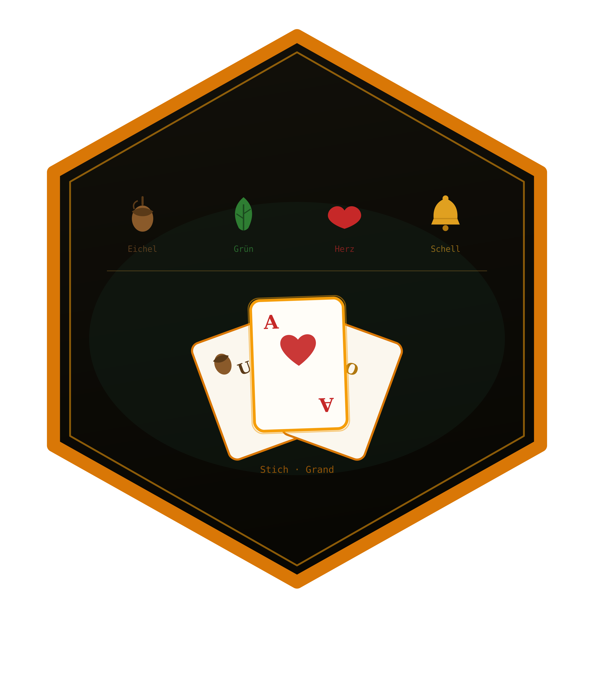

<!-- README.md is generated from README.Rmd. Please edit that file -->

```{r, include = FALSE}
knitr::opts_chunk$set(
  collapse = TRUE,
  comment = "#>",
  fig.path = "man/figures/README-",
  out.width = "100%"
)
```

# skatR 

<!-- badges: start -->
[](https://github.com/r-heller/skatR/actions/workflows/R-CMD-check.yaml)
[](https://github.com/r-heller/skatR/actions/workflows/pkgdown.yaml)
[](https://app.codecov.io/gh/r-heller/skatR?branch=main)
[](https://lifecycle.r-lib.org/articles/stages.html#experimental)
[](https://opensource.org/licenses/MIT)
<!-- badges: end -->

**skatR** is a toolkit for analysing and simulating the German card game
**Skat**. It provides a configurable rules engine (tournament and casual
variants), bidding-value computation, players spanning rule-based heuristics
through determinized Monte Carlo to an exact double-dummy solver, Monte Carlo
simulation over many deals, and tidy analysis and visualisation of outcomes.

## Installation

```{r, eval = FALSE}
# install.packages("remotes")
remotes::install_github("r-heller/skatR")
```

## Quick start

Deal a hand and play it out. Every seat is a strategy object, so the same call
covers random, heuristic, and search-based play.

```{r quick-start}
library(skatR)

deal <- sk_deal(seed = 42)
game <- sk_play_game(deal$hands, deal$skat, declarer = 1, game_type = "grand")
game$result
```

Repeat it a few hundred times to see how a configuration performs.

```{r simulate, fig.width = 7, fig.height = 4, fig.alt = "Histogram of declarer card points across 500 simulated grand games, filled by whether the declarer won, with a dashed line at the 61-point winning threshold."}
sim <- sk_simulate(n = 500, game_type = "grand", seed = 1, verbose = FALSE)
mean(sim$won)

sk_plot_points(sim)
```

Or solve an endgame exactly. The double-dummy solver runs an alpha-beta search
in C++ and returns the card points the declarer can guarantee against perfect
defence.

```{r solve}
hands <- list(c("CJ", "SA"), c("HA", "H9"), c("DA", "D9"))
sk_solve_dd(hands, game_type = "grand", declarer = 1)
```

## What is in the box

| Area | Functions |
|------|-----------|
| Cards and ordering | `sk_full_deck()`, `sk_card()`, `sk_points()`, `sk_card_order()`, `sk_strength()`, `sk_is_trump()`, `sk_effective_suit()` |
| Bidding | `sk_base_value()`, `sk_matadors()`, `sk_game_value()` |
| Play and scoring | `sk_legal_moves()`, `sk_trick_winner()`, `sk_count_points()`, `sk_score_game()` |
| Players | `sk_player()`, `sk_choose()`, `sk_mcts_move()` |
| Solver | `sk_solve_dd()` |
| Simulation | `sk_deal()`, `sk_play_game()`, `sk_simulate()` |
| Plots | `sk_plot_points()`, `sk_plot_winrate()` |
| Rules and demo | `sk_ruleset()`, `sk_run_app()` |

`vignette("skatR")` walks through all of it in order.

## License

MIT (c) Raban Heller
