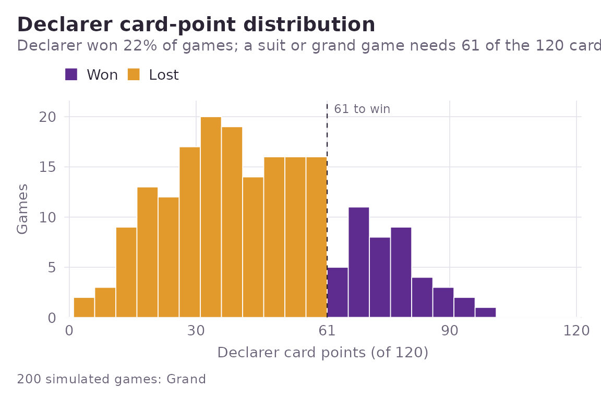
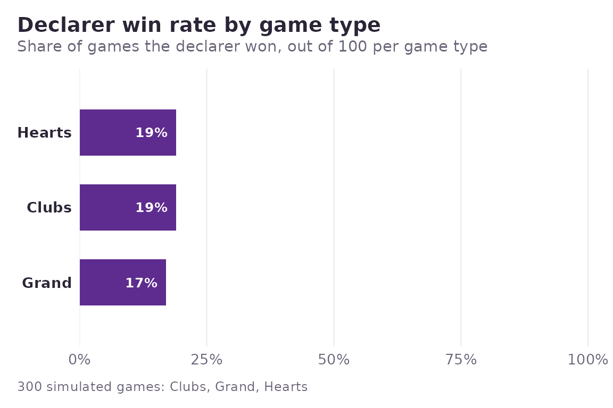

# Getting started with skatR

``` r

library(skatR)
```

Skat is a three-handed trick-taking game played across the
German-speaking world. One player – the *declarer* – takes on the other
two, having first won an auction for the right to name the game. This
vignette walks through the package in the order the game itself unfolds:
the deck, the ordering the game type imposes on it, the deal, the play,
the bidding arithmetic, and finally simulation and exact analysis.

## The deck

Skat uses a 32-card deck: sevens through aces in four suits. The card
points (jacks 2, queens 3, kings 4, tens 10, aces 11) sum to 120, and 61
of them wins a suit or grand game.

``` r

sk_full_deck()
#> 32 Skat cards: ♣A ♣10 ♣K ♣Q ♣J ♣9 ♣8 ♣7 · ♠A ♠10 ♠K ♠Q ♠J ♠9 ♠8 ♠7 · ♥A ♥10 ♥K
#> ♥Q ♥J ♥9 ♥8 ♥7 · ♦A ♦10 ♦K ♦Q ♦J ♦9 ♦8 ♦7
sum(sk_points(sk_full_deck()))
#> [1] 120
```

## Trick-taking order depends on the game type

This is where Skat differs most from other trick-taking games. In suit
and grand games all four jacks are trumps, ranked clubs \> spades \>
hearts \> diamonds, and the jack of clubs is always the strongest card
in the pack. In a suit game the named suit joins them as trumps below
the jacks.

``` r

tail(sk_card_order("grand"), 4)   # the strongest four cards
#> [1] "DJ" "HJ" "SJ" "CJ"
sk_is_trump(c("CJ", "HJ", "HA"), game_type = "hearts")
#> [1] TRUE TRUE TRUE
```

Because a jack is a trump rather than a card of its printed suit,
leading one demands a trump from the other players.
[`sk_effective_suit()`](https://r-heller.github.io/skatR/reference/sk_effective_suit.md)
is the function that encodes this, using `"T"` for trump, and
[`sk_legal_moves()`](https://r-heller.github.io/skatR/reference/sk_legal_moves.md)
applies it:

``` r

sk_effective_suit(c("CJ", "HA", "D10"), game_type = "hearts")
#> [1] "T" "T" "D"
sk_legal_moves(c("HA", "H7", "CJ", "DA"), led = "SJ", game_type = "hearts")
#> 3 Skat cards: ♣J · ♥A ♥7
```

Null games are the exception: no trumps at all, and the ten drops back
to its natural place between the nine and the jack.

``` r

head(sk_card_order("null"), 8)
#> [1] "C7"  "C8"  "C9"  "C10" "CJ"  "CQ"  "CK"  "CA"
sk_trick_winner(c("H10", "HJ", "H9"), game_type = "null")
#> [1] 2
```

## Dealing and playing a game

[`sk_deal()`](https://r-heller.github.io/skatR/reference/sk_deal.md)
deals ten cards to each seat plus a two-card skat.
[`sk_play_game()`](https://r-heller.github.io/skatR/reference/sk_play_game.md)
plays all ten tricks and scores the result.

``` r

deal <- sk_deal(seed = 42)
deal
#> <sk_deal>: three ten-card hands and the two-card skat
#> Player 1  33 pts  ♣Q ♣8 ♣7 · ♠K · ♥A ♥7 · ♦10 ♦Q ♦J ♦8
#> Player 2  21 pts  ♣K ♣J ♣9 · ♠A ♠9 ♠8 ♠7 · ♥9 · ♦K ♦7
#> Player 3  56 pts  ♣A · ♠10 ♠Q ♠J · ♥10 ♥K ♥Q ♥J ♥8 · ♦A
#> Skat      10 pts  ♣10 · ♦9

game <- sk_play_game(deal$hands, deal$skat, declarer = 1, game_type = "grand")
game$result
#> <sk_result>: declarer lost
#> • Game value: 120
#> • Score: -240
#> • Schneider: yes
#> • Schwarz: no
```

The game object keeps the tricks, so the play can be inspected
afterwards:

``` r

game$tricks[[1]]
#> $cards
#> [1] "C7" "C9" "CA"
#> 
#> $leader
#> [1] 1
#> 
#> $winner
#> [1] 3
#> 
#> $points
#> [1] 11
game$declarer_points
#> [1] 25
```

## Bidding values

The game value combines a base value (diamonds 9 up to grand 24) with a
matador (“Spitzen”) multiplier: the unbroken run of top trumps the
declarer holds, or lacks, counting down from the jack of clubs.

``` r

sk_matadors(c("CJ", "SJ", "HA", "HK", "H10"), game_type = "hearts")
#> $with
#> [1] TRUE
#> 
#> $count
#> [1] 2
sk_game_value(c("CJ", "SJ", "HA", "HK", "H10"), game_type = "hearts")
#> [1] 30
```

Null games ignore all of that and use four fixed values instead.

``` r

sk_game_value(character(0), game_type = "null")
#> [1] 23
sk_game_value(character(0), game_type = "null", ouvert = TRUE)
#> [1] 46
```

## Simulation

[`sk_simulate()`](https://r-heller.github.io/skatR/reference/sk_simulate.md)
deals and plays many games, returning one tidy row per game.

``` r

sim <- sk_simulate(n = 200, game_type = "grand", seed = 1, verbose = FALSE)
mean(sim$won)
#> [1] 0.215
sk_plot_points(sim)
```



Because the result is a plain tibble, summarising it needs nothing
special:

``` r

library(dplyr)
#> 
#> Attaching package: 'dplyr'
#> The following objects are masked from 'package:stats':
#> 
#>     filter, lag
#> The following objects are masked from 'package:base':
#> 
#>     intersect, setdiff, setequal, union

sim |>
  group_by(won) |>
  summarise(games = n(), mean_points = mean(declarer_points))
#> # A tibble: 2 × 3
#>   won   games mean_points
#>   <lgl> <int>       <dbl>
#> 1 FALSE   157        37.0
#> 2 TRUE     43        76.2
```

Comparing game types is a matter of binding a few runs together:

``` r

runs <- do.call(rbind, lapply(
  c("grand", "clubs", "hearts"),
  function(gt) sk_simulate(n = 100, game_type = gt, seed = 1, verbose = FALSE)
))
sk_plot_winrate(runs)
```



## Exact endgame analysis

[`sk_solve_dd()`](https://r-heller.github.io/skatR/reference/sk_solve_dd.md)
computes, by exhaustive alpha-beta search in C++, the maximum card
points the declarer can guarantee against perfect defence, given that
every hand is known. The total includes the points on the declarer’s own
cards.

``` r

hands <- list(c("CJ", "SA"), c("HA", "H9"), c("DA", "D9"))
sk_solve_dd(hands, game_type = "grand", declarer = 1)
#> [1] 35
```

The search is exponential in the number of cards left, so it is above
all a tool for endgames. A two-trick hearts position, worked by hand
below, is instant:

``` r

# Declarer leads HJ (a trump); seat 2 must follow with H7 and seat 3, holding
# no trump, throws its cheaper diamond. The declarer then leads C7 into seat
# 2's ace and loses the second trick. Total: 2 + 0 + 10.
sk_solve_dd(
  list(c("HJ", "C7"), c("H7", "CA"), c("DA", "D10")),
  game_type = "hearts", declarer = 1, leader = 1
)
#> [1] 12
```

Alpha-beta pruning, move ordering and a transposition table keep the
cost down, but only so far, so
[`sk_solve_dd()`](https://r-heller.github.io/skatR/reference/sk_solve_dd.md)
refuses positions deeper than `max_tricks` (eight cards per hand by
default) rather than disappearing into a search you did not intend to
start. Whole ten-trick deals are within reach if you raise the guard and
are willing to wait: most solve in well under a second, awkward ones in
tens of seconds.

``` r

deal <- sk_deal(seed = 1)
sk_solve_dd(deal$hands, game_type = "grand", declarer = 1, max_tricks = 10)
#> [1] 73
```

## Rule variants

[`sk_ruleset()`](https://r-heller.github.io/skatR/reference/sk_ruleset.md)
collects the options that separate tournament play from a casual round.

``` r

sk_ruleset("tournament")
#> <sk_ruleset> ("tournament")
#> • Bock rounds: FALSE
#> • Ramsch on pass: FALSE
#> • Kontra/Re: FALSE
sk_ruleset("casual", bock = TRUE)
#> <sk_ruleset> ("casual")
#> • Bock rounds: TRUE
#> • Ramsch on pass: TRUE
#> • Kontra/Re: TRUE
```

## An interactive demo

[`sk_run_app()`](https://r-heller.github.io/skatR/reference/sk_run_app.md)
launches a small Shiny application that runs simulations and plots the
results; it needs the suggested **shiny** package.
